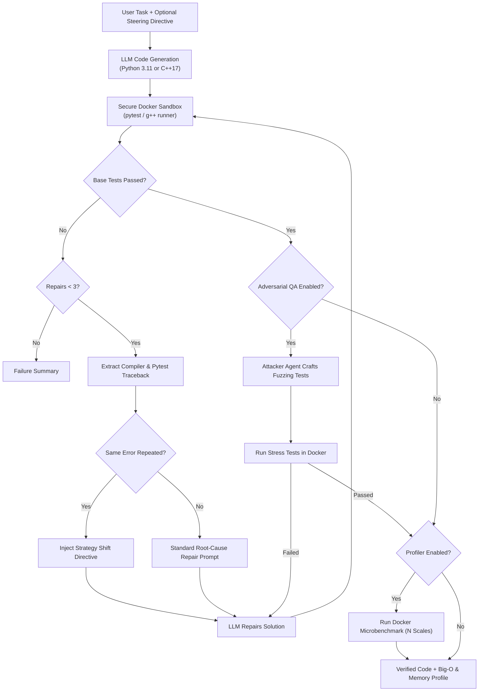

# SandboxAgent

An autonomous coding agent that takes programming tasks in plain English, generates Python 3.11 or C++17 implementations with an LLM, validates them inside a locked-down, air-gapped Docker sandbox, stress-tests solutions with an Adversarial QA agent, and empirically profiles Big-O complexity and memory.

[](https://www.python.org/)
[](https://isocpp.org/)
[](https://www.docker.com/)
[](LICENSE)


---

## Key Agentic Capabilities

1. **Autonomous Self-Repair Loop**: Inspects compilation errors, test assertions, and runtime tracebacks from Docker and iteratively repairs failures (up to 3 attempts) with repeated-error detection.
2. **⚔️ Adversarial QA Agent (Fuzzing & Critique)**: Deploys a distinct "Attacker" agent persona that writes vicious boundary and edge-case unit tests (empty collections, negative bounds, scale tests) to challenge and patch the solution.
3. **⚡ Docker Big-O & Memory Profiler**: Generates an empirical micro-benchmark run inside the sandbox across scaling input sizes $N$, measuring execution time and peak memory to estimate computational complexity ($O(N)$, $O(N \log N)$, etc.).
4. **🎯 Human-in-the-Loop Steering**: Allows users to inject explicit algorithmic directives (e.g. *"Solve in-place with two pointers, avoid recursion"*) that guide both initial code synthesis and subsequent repair iterations.
5. **Dual-Language Polyglot Sandbox**: First-class support for both **Python 3.11** (pytest) and **C++17** (`g++ -O2 -std=c++17` with `<cassert>`).

---

## Benchmark Results

Evaluated against `bench/tasks.json` (20 problems spanning edge cases, off-by-one errors, interval merges, cache evictions, parsing, and matrix traversal).

| Difficulty | Tasks | 0-Repair Pass (1st Try) | Final Pass (<= 3 Repairs) | Repair Boost |
|---|---|---|---|---|
| **Easy** | 5 | `[XX.X%]` (`[X]/5`) | `[YY.Y%]` (`[Y]/5`) | `[+ZZ.Z%]` |
| **Medium** | 10 | `[XX.X%]` (`[X]/10`) | `[YY.Y%]` (`[Y]/10`) | `[+ZZ.Z%]` |
| **Hard** | 5 | `[XX.X%]` (`[X]/5`) | `[YY.Y%]` (`[Y]/5`) | `[+ZZ.Z%]` |
| **Overall** | **20** | **`[XX.X%]` (`[X]/20`)** | **`[YY.Y%]` (`[Y]/20`)** | **`[+ZZ.Z%]`** |

- **Repair Success Rate**: `[XX.X%]` of initial failures resolved autonomously
- **Average Attempts / Task**: `[X.XX]`
- **Average Tokens / Task**: `[X,XXX]`
- **Average Time / Task**: `[X.XX]s`

*(Run `python -B bench/run_eval.py` to regenerate results into `results.md`)*

---

## How It Works



---

## Sandbox Security Architecture

Generated code is never executed on the host system. Execution occurs strictly within an unprivileged Docker container enforced by Linux kernel security primitives:

| Restriction | Flag / Value | Threat Mitigated |
|---|---|---|
| **Air-gapped Network** | `--network none` | Blocks remote code exfiltration, credential harvesting, reverse shells, and SSRF attacks. |
| **Memory Limit** | `--memory 256m` | Prevents OOM host starvation caused by memory leaks or exponential object allocation. |
| **CPU Quota** | `--cpus 0.5` | Limits container to half a CPU core, preventing CPU exhaustion and thread-spinning denial of service. |
| **Process Cap** | `--pids-limit 64` | Neutralizes fork bombs (`:(){ :|:& };:`) and uncontrolled process spawning. |
| **Read-Only Root** | `--read-only` | Prevents file tampering, system binary alteration, and persistent disk modification. |
| **Volatile Temp** | `--tmpfs /tmp:rw,exec,size=64m` | Provides minimal in-memory scratch space for compiler output and caches; all state vanishes on exit. |
| **Unprivileged User** | `runner` (UID 1000) | Drops root capabilities, eliminating container breakout and privilege escalation vectors. |
| **Hard Timeout** | 10-15 seconds default | Automatically terminates and forcibly purges runaway or hanging processes (`docker rm -f`). |

---

## Quick Start

```bash
# 1. Clone the repository
git clone https://github.com/yourusername/coding-agent.git && cd coding-agent

# 2. Configure environment credentials
cp .env.example .env # populate OPENAI_API_KEY & LLM_MODEL

# 3. Install dependencies
pip install -r requirements.txt

# 4. Build the isolated sandbox image
docker build -t sandbox-agent .

# 5. Launch the Streamlit application
streamlit run app.py
```

To run tasks directly via the CLI:
```bash
python -B -m agent.controller "Write an LRU Cache" --language cpp --adversarial --profile
```

---

## Design Decisions & Trade-offs

- **Container Subprocess vs. Docker SDK**: Invokes the `docker` CLI via `subprocess` with explicit security arguments. This ensures zero third-party agent dependencies and transparent, verifiable CLI flags.
- **Strict Read-Only Mounts**: Source files are mounted read-only (`:ro`). Compilations and bytecode generation are routed to a volatile tmpfs (`/tmp`) to maintain clean isolation without permission errors.
- **Adversarial Debias**: Code generators suffer from confirmation bias when generating their own tests; introducing a dedicated adversarial persona forces robustness on blind spots.
- **Provider Agnostic**: Configured through centralized constants (`MODEL_NAME` in `agent/llm.py`) with support for any OpenAI-compatible API endpoint (OpenAI, Groq, OpenRouter, Local vLLM/Ollama).

---

## Future Roadmap

- **Multi-File Workspace Support**: Expand sandbox mounting to support multi-file modules and package directory structures.
- **Automated Property Testing**: Integrate Hypothesis and rapid fuzz testing generation for property invariants.
- **Cross-Model Benchmark Matrix**: Run standardized evaluations across open-source and proprietary models (e.g., Claude 3.5 Sonnet vs. GPT-4o vs. DeepSeek) to compare repair cost efficiency.
